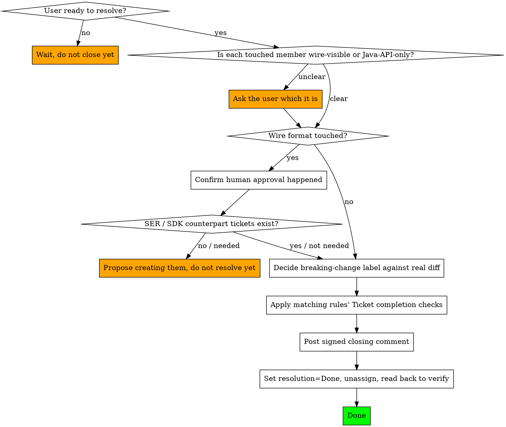

# Ticket Wrap-Up for nJAMS MessageFormat

## Overview

Closing a ticket is the mirror image of `njams-ticket-start`, and just as easy to do inconsistently without a list. In this repository the most consequential check is not the label — it is whether a wire-format change actually went through its gate and whether the other side of the contract knows about it. A `MSG` ticket that resolves cleanly while nJAMS Server has no corresponding `SER` ticket leaves a format change that will surface as a runtime mismatch in someone else's deployment, long after this ticket looks done.

## Hard Rules

**Only run this when the user is actually resolving the ticket** — not just because the code looks finished to you. Verification passing is necessary but not sufficient; wait for the user's go-ahead to close.

**If the change touched the wire format, confirm the gate in `wire-contract.md` was actually satisfied** — a human explicitly confirmed the format change — **and that the counterpart tickets exist**: a `SER` ticket if nJAMS Server must adapt, an `SDK` ticket if the SDK must. Do not resolve the ticket if either is missing. Do not substitute a `breaking-change` label for this; the label does not govern the wire format.

**Decide the `breaking-change` label against the actual diff, for Java-API changes only.** In most cases nothing was set at kickoff — treat this as the real decision, not a recheck. Add it if the change alters a public/protected signature, return type, parameter type, or removes a member or alters observable behavior. Remove it if the change turned out purely additive or internal. New methods, classes and overloads are never breaking on their own.

**If it is unclear whether a touched member is wire-visible or Java-API-only, ask — do not guess.** A bean property is wire-visible; a lookup static, convenience method or listener interface is Java-API-only; a member can be both. Getting this wrong is exactly the failure this separation exists to prevent.

**Apply the project rules' completion checks.** Rules under `.claude/rules/` contribute their own checks in a section titled `## Ticket completion checks`. Before resolving, apply every such section whose rule's path scope (the `globs:` frontmatter, or the "Applies to" column in `CLAUDE.md` for rules without one) matches files in the ticket's diff. A check that says "propose" means propose to the user and wait for the answer; do not resolve the ticket while a proposed check is still unanswered.

**Post a closing comment before or as part of resolving**, and keep it brief: state that the issue is resolved and optionally the root cause. Implementation detail belongs in commit messages. Every comment posted to Jira must end with:
```
---
_Generated by Claude Code_
```
Write it in Markdown with `contentFormat=markdown` — wiki markup (`h2.`, `_..._`) renders broken.

**Set resolution to `Done` and clear the assignee** as part of the same transition. An empty resolution leaves the ticket unresolved in Jira's eyes even in a done status, which blocks releasing its fix version — pass the resolution on the transition and read the ticket back to confirm it, since the transition reports success either way.

## Workflow



## Steps in Detail

**1. Confirm this is really the close.**
If the user says "looks good" but has not said to resolve the ticket, that is not a trigger — keep working or wait.

**2. Classify each touched member.**
For every changed `public`/`protected` member, decide whether it is wire-visible (a bean property, enum constant, or a type/package name a mapper binds to) or Java-API-only (a lookup static, convenience method, listener interface, or the deprecated wrapper layer). A member can be both. If that is genuinely unclear, ask the user rather than deciding on a guess.

**3. For wire-visible changes, verify the gate and the counterparts.**
Confirm a human explicitly approved the format change, and that a `SER` ticket exists if the Server must adapt and an `SDK` ticket if the SDK must. If one is missing, propose creating it (never create it autonomously) and hold off resolving until that is settled.

**4. For Java-API changes, decide the label against the real diff.**
Set or remove `breaking-change` per the criteria. Do not apply it to wire-format changes.

**5. Apply the rules' completion checks.**
List the files in the ticket's diff, then grep `.claude/rules/*.md` for the heading `## Ticket completion checks`. Carry out each check whose rule scope matches those files — currently: the wire-contract gate and counterpart tickets, a clean `mvn generate-sources javadoc:javadoc`, the `breaking-change` label decision, and a passing `mvn clean test` with the actual result reported. Skip rules whose scope does not match the diff.

**6. Comment, then resolve.**
Post the closing comment, then set resolution to `Done` and clear the assignee, and read the ticket back to confirm the resolution actually stuck.

## Common Mistakes

| Mistake | Correct Approach |
|---------|-----------------|
| Posting a closing comment because the code feels done | Only post it when the user is actually resolving the ticket |
| Resolving a format change with no `SER` ticket for the Server side | Confirm the counterpart tickets exist first; propose them if not |
| Setting a `breaking-change` label for a wire-format change | That goes through the `wire-contract.md` gate, not the label |
| Guessing whether a touched member is wire-visible when it is ambiguous | Ask the user instead of picking on a guess |
| Transitioning to Done without a resolution | Pass resolution `Done` on the transition and read the ticket back — an empty resolution blocks the fix version's release |
| Resolving without clearing the assignee | Both happen together: resolution=Done and unassigned |
| Resolving without checking the rules' `## Ticket completion checks` | Grep `.claude/rules/*.md` for the heading and apply the ones whose scope matches the diff |
| Claiming the tests pass without running them | Run `mvn clean test` and report the real counts |
| Writing a long technical closing comment | Keep it to root cause plus resolution; details belong in commits |
