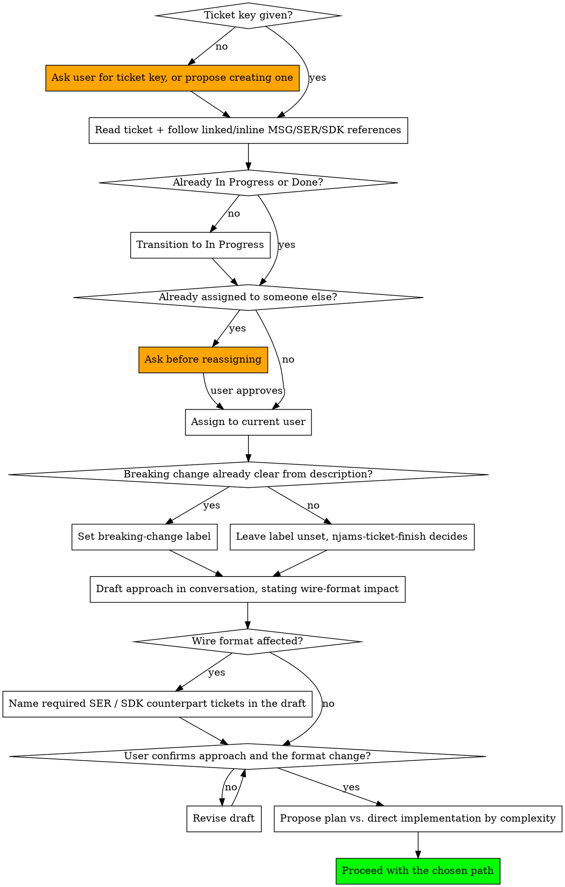

# Ticket Kickoff for nJAMS MessageFormat

## Overview

Every piece of work in this repo traces back to a Jira ticket, and the first few minutes are always the same handful of bookkeeping steps. Doing them first, before any code is touched, keeps the ticket's status honest for anyone looking at the board.

Kickoff here carries one extra question the SDK's equivalent doesn't: **does this ticket change the wire format?** If it does, the work is not self-contained — nJAMS Server and the SDK bind to these types, the change needs explicit human confirmation before it is made, and counterpart tickets may be required. Establishing that at kickoff, while the approach is still being drafted, is far cheaper than discovering it at commit time.

The `breaking-change` label is deliberately *not* part of this bookkeeping in the general case. At kickoff there's usually no diff yet, so guessing produces a label as likely to be wrong as right — and a wrong label looks decided when it isn't. Only touch it here if the ticket description itself already settles the question; otherwise leave it and let `njams-ticket-finish` decide once the real change exists.

## Hard Rules

**Confirm the ticket key before doing anything else.** If the user hasn't given one, ask for it or offer to create one — never invent a ticket key or proceed without one. Creating a ticket is never something to do on your own initiative; propose it and wait for explicit confirmation.

**Read the ticket, and follow its linked issues.** Check formal issue links and also scan summary, description and comments for inline references — including `SER-NNN` and `SDK-NNN`. In this project the reason a field exists usually lives in a Server or SDK ticket, not in `MSG`.

**Transition the ticket to `In Progress`**, unless it is already in a started or done state.

**Assign the ticket to the current Atlassian user.** Call `atlassianUserInfo` to get the `account_id` and set it as assignee. If the ticket is already assigned to someone else, stop and ask before reassigning.

**Establish early whether the work touches the wire format**, and say so explicitly as part of the drafted approach. Per `wire-contract.md`, a wire-format change needs the user's explicit confirmation before it is made, and a `SER` (and/or `SDK`) counterpart ticket when the other side must adapt. Raise both at kickoff rather than at commit time. Never start modifying model types on the assumption that approving the ticket approved the format change.

**Do not guess at the `breaking-change` label.** Only set it now if the ticket description already makes the answer unambiguous — e.g. it explicitly says "remove deprecated class X". A ticket that just describes a desired capability does not yet know its own answer; leave the label untouched and defer to `njams-ticket-finish`. Remember the label covers Java-API breaks only — wire-format changes go through the confirmation gate instead.

**If the ticket is being created on the spot**, set its `fix version` to the current `pom.xml` version with `-SNAPSHOT` stripped — checking the remote branch's pom if the local checkout may be behind — then run the rest of this kickoff immediately after.

**Draft and confirm a solution approach before writing any document or code.** After the bookkeeping above, analyze the ticket and sketch a proposed solution directly in conversation — never as a written plan or code file — and present it for confirmation. The draft must state whether the wire format is affected and which consumers need a counterpart change.

**Once the approach is confirmed, propose the next step by complexity — an implementation plan or direct implementation — and wait for the user's choice.** Never move straight to implementation on your own judgment.

## Workflow

## Steps in Detail

**1. Confirm the ticket.**
If a key like `MSG-27` is already in the conversation, use it. If not, ask — or, only with explicit go-ahead, create one. Never guess.

**2. Read it fully, including what it links to.**
Fetch the ticket and its formal links, then re-read summary/description/comments for inline `MSG-NNN`, `SER-NNN` and `SDK-NNN` mentions and fetch those too. A one-line ticket here can hide a constraint agreed with the Server team months earlier.

**3. Transition and assign.**
Skip if already `In Progress` or further — do not bounce it backwards. Get your own `account_id` via `atlassianUserInfo` first.

**4. Determine wire-format impact.**
Read the types the ticket would touch. Decide whether the change is visible to a consumer's object mapper, and whether Server or SDK need a counterpart change. Carry that conclusion into the draft — do not leave it implicit.

**5. Only set the `breaking-change` label if the description already makes it obvious.**
Otherwise leave it alone. Remember it applies to Java-API breaks, not wire-format changes.

**6. Draft a solution approach and get it confirmed.**
Sketch it in conversation, not as a file. If it changes the wire format, the confirmation you need is for *that specific change*, stated plainly — not a general "sounds good" about the ticket.

**7. Propose the right next step.**
An implementation plan (via `superpowers:writing-plans`) or direct implementation for something small. Wait for the user to pick.

## Common Mistakes

| Mistake | Correct Approach |
|---------|-----------------|
| Starting to code before the ticket is even read | Read the ticket and its links first — including its `SER`/`SDK` references |
| Treating ticket approval as approval of a format change | The wire-format change needs its own explicit confirmation, stated as such |
| Discovering at commit time that Server needs a counterpart ticket | Establish wire-format impact at kickoff and name the counterpart tickets in the draft |
| Reassigning someone else's ticket silently | Ask before taking over a ticket already assigned to another person |
| Guessing at the breaking-change label when it is not yet knowable | Leave it unset; `njams-ticket-finish` decides against the real diff |
| Creating a Jira ticket without asking | Propose it and wait for explicit confirmation, every time |
| Writing a plan file before the user has confirmed the approach | Draft and confirm in conversation first |
